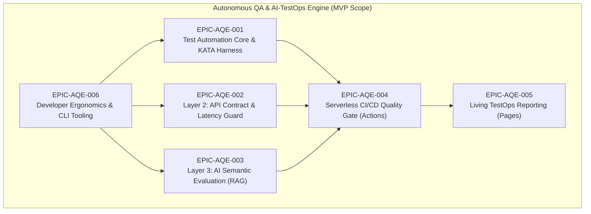

# PRD: MVP Scope - Autonomous QA & AI-TestOps Engine

> **Phase:** 2 - Architecture  
> **Document:** Product Requirements Document (PRD) — MVP Scope  
> **Status:** Approved / Baseline  
> **Project Key:** `AQE` (Autonomous QA Engine)  

---

## 1. In Scope (Must Have) — Core MVP Epics

The MVP scope is organized into **6 core epics** structured to deliver the 3-layer Quality Gate, serverless CI/CD execution, interactive reporting, and developer tooling.

---

### EPIC-AQE-001: Test Automation Core & KATA Architectural Harness
* **Category:** Foundation & Layer 1 UI Automation
* **Description:** Establishes the core TypeScript testing architecture utilizing the layered KATA pattern (`TestContext` $\rightarrow$ `UiBase`/`ApiBase` $\rightarrow$ Domain ATCs $\rightarrow$ `TestFixture`) and Playwright for high-speed, zero-flakiness web automation.
* **User Stories:**
  * **US 1.1:** As an SDET (Alex), I want a structured KATA layered architecture separating configuration, base helpers, domain components, and fixtures, so that test code remains clean, DRY, and scalable.
  * **US 1.2:** As an SDET (Alex), I want a standardized Page Object Model (POM) leveraging auto-waiting locators (`getByRole`, `getByTestId`), so that browser tests run reliably without arbitrary sleeps (`waitForTimeout`) or race conditions.
  * **US 1.3:** As an SDET (Alex), I want multi-browser parallel execution across Chromium, Firefox, and WebKit, so that cross-browser compatibility is verified simultaneously in under 60 seconds locally.
  * **US 1.4:** As an SDET (Alex), I want atomic Acceptance Test Cases (ATCs) with isolated state fixtures, so that any test case can execute independently without leaking state or depending on preceding tests.

---

### EPIC-AQE-002: Layer 2: API Contract Validation & Latency SLA Guard
* **Category:** API Quality & Backend SLA Assurance
* **Description:** Provides automated REST API testing validating strict OpenAPI and JSON Schema payload compliance alongside percentile response time budgets ($p95 < 500\text{ms}$).
* **User Stories:**
  * **US 2.1:** As an SDET (Alex), I want automated JSON Schema validation for all critical API endpoints, so that breaking schema changes and payload drift are caught before frontend integration.
  * **US 2.2:** As an Engineering Manager (Sofia), I want strict percentile latency budget assertions ($p95 < 500\text{ms}$, $p99 < 1000\text{ms}$), so that backend performance regressions and database bottlenecks fail the build before production release.
  * **US 2.3:** As a Developer (Marcus), I want automated TypeScript type synchronization from OpenAPI specifications (`bun run api:sync`), so that test payloads remain type-safe and aligned with backend contracts.
  * **US 2.4:** As an SDET (Alex), I want built-in HTTP request, header, status code, and auth token helpers inside `ApiBase`, so that writing API integration test cases requires minimal repetitive boilerplate.

---

### EPIC-AQE-003: Layer 3: AI Semantic Evaluation & RAG Faithfulness Harness
* **Category:** GenAI / LLM Semantic Quality & Hallucination Fencing
* **Description:** Implements a Python 3.11+ / Pytest evaluation harness computing vector embedding cosine similarity, context faithfulness thresholds, and prompt regression benchmarking to eliminate hallucinations.
* **User Stories:**
  * **US 3.1:** As a RAG Builder (Marcus), I want automated vector embedding cosine similarity assertions between generated answers and expected ground truth, so that semantic drift is measured quantitatively whenever prompts update.
  * **US 3.2:** As an AI Engineer (Marcus), I want a Context Faithfulness verification fence that checks if claims in generated responses are strictly supported by retrieved context chunks, so that factual hallucinations are blocked pre-merge.
  * **US 3.3:** As an SDET (Alex), I want a curated synthetic regression benchmark dataset covering positive, edge-case, and adversarial prompts, so that model and prompt updates can be regression-tested reliably.
  * **US 3.4:** As an Engineering Manager (Sofia), I want configurable semantic threshold parameters (e.g., faithfulness $\ge 0.85$, similarity $\ge 0.80$), so that our team can enforce strict quality fences suited to our domain risk tolerance.

---

### EPIC-AQE-004: Serverless CI/CD Quality Gate (GitHub Actions)
* **Category:** Continuous Integration & DevOps Automation
* **Description:** Orchestrates an automated, zero-cost serverless CI/CD pipeline executing on ephemeral GitHub Actions runners triggered by Pull Requests and daily cron schedules.
* **User Stories:**
  * **US 4.1:** As an Engineering Manager (Sofia), I want a GitHub Actions workflow (`ci.yml`) that runs all three testing layers in parallel on standard Linux runners, so that the team incurs $0 in fixed monthly cloud infrastructure costs.
  * **US 4.2:** As a Developer (Marcus), I want fast PR check feedback completing in under 5 minutes with intelligent caching (Bun dependencies, Python venv, Playwright binaries), so that the Quality Gate does not block my development flow.
  * **US 4.3:** As an SDET (Alex), I want a daily scheduled health check cron (e.g., 02:00 UTC) executing against staging and production endpoints, so that synthetic health is monitored continuously without manual intervention.
  * **US 4.4:** As an Engineering Manager (Sofia), I want branch protection rules requiring all three Quality Gate layers to pass before merging into `main`, so that regressions are mathematically prevented from entering production.

---

### EPIC-AQE-005: Living TestOps Reporting & Showcase (GitHub Pages)
* **Category:** Observability, Reporting & Public Portfolio Showcase
* **Description:** Automates the generation and Edge CDN deployment of interactive, visual Allure TestOps and Playwright HTML reports directly to GitHub Pages at $0 hosting cost.
* **User Stories:**
  * **US 5.1:** As an Engineering Manager (Sofia), I want interactive, multi-layer HTML reports automatically published to GitHub Pages, so that stakeholders can inspect test runs and historical trends without logging into complex SaaS tools.
  * **US 5.2:** As an SDET (Alex), I want failed test steps in the report to include captured screenshots, full-page DOM snapshots, and network HAR traces, so that root causes can be diagnosed in seconds.
  * **US 5.3:** As an AI Engineer (Marcus), I want Layer 3 semantic evaluations to include visual diffs and metric charts (faithfulness score, cosine similarity distributions) in the test report, so that prompt behavior is clear and explainable.
  * **US 5.4:** As a Technical Evaluator / Recruiter, I want a live portfolio showcase link in `README.md` displaying the latest passing execution of the engine, so that I can verify production-grade SDET mastery in action.

---

### EPIC-AQE-006: Developer Ergonomics & CLI Tooling
* **Category:** Developer Experience & Local Tooling
* **Description:** Provides an intuitive developer CLI and one-command onboarding utilities for local test execution, linting, formatting, and template updates.
* **User Stories:**
  * **US 6.1:** As an SDET (Alex), I want a single command (`bun run test:all`) that runs the complete 3-layer test suite locally, so that I can verify full-system health before opening a Pull Request.
  * **US 6.2:** As a Developer (Marcus), I want pre-configured linters (`bun run lint`) and formatters (`bun run format`) enforced via Husky pre-commit hooks, so that code quality and formatting remain consistent.
  * **US 6.3:** As an SDET (Alex), I want environment-driven configuration via `.env` and `.agents/project.yaml`, so that test suites can easily switch between `local`, `staging`, and `production` targets without modifying test code.

---

## 2. Out of Scope (Nice to Have — Future Roadmap v2+)

The following capabilities are deliberately excluded from the MVP to preserve focus, rapid delivery, and the $0 serverless promise:

* **Dedicated Kubernetes / Grid Runners:** Running tests on self-hosted Selenium grids or Kubernetes clusters (the MVP strictly leverages serverless ephemeral GitHub Actions).
* **Real-time LLM Token Cost Forecasters:** Real-time billing monitors predicting OpenAI/Anthropic cloud invoices (focused purely on functional, contract, and semantic quality in MVP).
* **Automated Self-Healing Locators:** Dynamic runtime AI self-healing of broken DOM selectors (the MVP enforces rock-solid `data-testid` and accessible role locators).
* **Multimodal Audio/Video Evaluation:** Testing audio streams or video generation models (MVP focuses strictly on web UI, REST API JSON schemas, and text/RAG embeddings).
* **Paid Commercial SaaS Connectors:** Out-of-the-box sync with Datadog Synthetics, Dynatrace, or Jira Cloud Xray (kept lightweight; native open-source Allure and GitHub Pages reporting prioritize zero vendor lock-in).

---

## 3. Success Criteria & Launch Readiness

The MVP is considered complete and launch-ready when all the following criteria are satisfied:

| Metric / Requirement | Target Baseline | Verification Method |
| :--- | :--- | :--- |
| **Full 3-Layer Execution** | $100\%$ test pass rate across all 3 layers | Automated run via `bun run test:all` |
| **CI Pipeline Execution Budget** | $< 5\text{ minutes}$ total run time | GitHub Actions job execution timer |
| **Pipeline Flakiness Rate** | $< 1\%$ false positive failure rate | 100 consecutive automated CI runs |
| **Cross-Browser Parity** | $100\%$ passing on Chromium, Firefox, WebKit | Headless parallel matrix execution |
| **Hallucination Detection Proof** | $\ge 70\%$ detection on injected drift dataset | Synthetic benchmark in `tests/ai_eval/` |
| **Zero Infrastructure Cost** | **$0.00 / month** fixed recurring spend | Verified GitHub Actions & Pages free quotas |
| **Developer Onboarding Speed** | $< 15\text{ minutes}$ from clone to passing run | Clean-machine onboarding test run |
| **Live Showcase Deployment** | Live URL active on GitHub Pages | `https://marttinroman.github.io/autonomous-qa-engine` |
