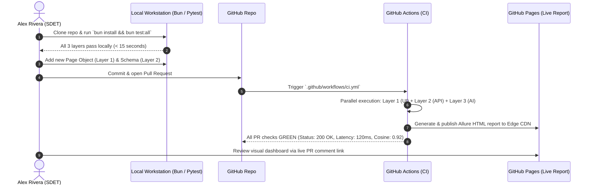
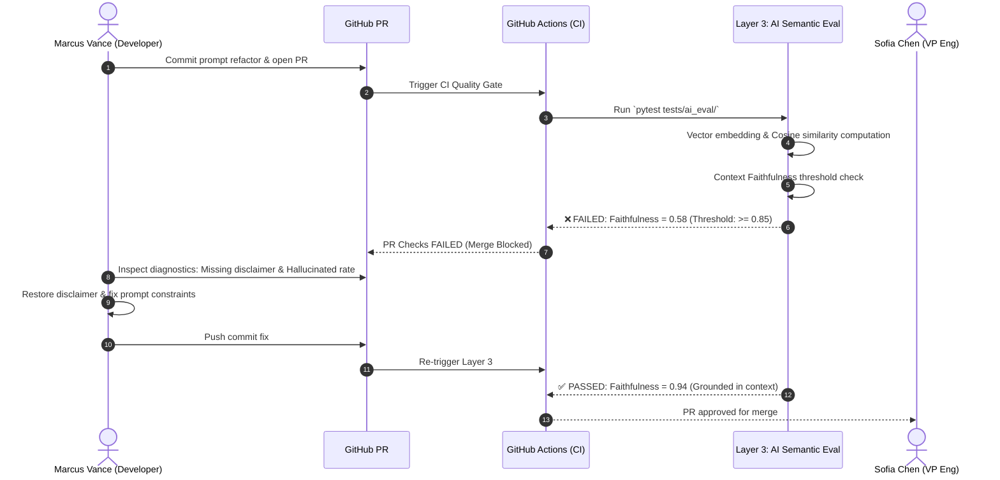
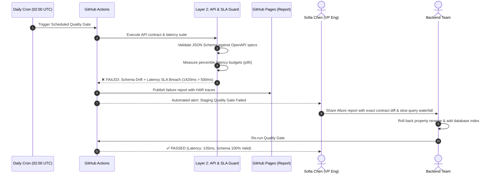

# PRD: User Journeys - Autonomous QA & AI-TestOps Engine

> **Phase:** 2 - Architecture  
> **Document:** Product Requirements Document (PRD) — User Journeys  
> **Status:** Approved / Baseline  
> **Target Audience:** SDETs, Engineering Leadership, and Full-Stack Developers  

---

## Journey 1: Turnkey Setup and Flake-Free Quality Gate Execution (Happy Path)

* **Persona:** Alex Rivera (Senior SDET)
* **Scenario:** Alex is onboarding a high-velocity product team to the Autonomous QA & AI-TestOps Engine. He wants to clone the starter, run all three test layers locally, customize a new user journey, and establish an automated pre-merge Quality Gate in GitHub Actions.



### Flow Steps

#### Step 1: Clone and One-Command Local Verification
* **User Action:** Alex clones the repository and executes:
  ```bash
  bun install
  bun run test:all
  ```
* **System Response:** Bun installs dependencies in $< 10$ seconds. Playwright launches headless Chromium, Firefox, and WebKit runners for Layer 1; the contract tester validates endpoints for Layer 2; and Pytest evaluates RAG semantic similarity for Layer 3. The console outputs green checkmarks across all three layers in $< 20$ seconds.
* **Friction / Pain Point:** Missing browser dependencies on fresh machines.
  * *Resolution:* Clear CLI instructions with `bunx playwright install --with-deps`.

#### Step 2: Customizing Domain Components (KATA Pattern)
* **User Action:** Alex creates a new Page Object (`tests/components/ui/DashboardPage.ts`) using Playwright's POM with auto-waiting locators and adds a corresponding API schema.
* **System Response:** TypeScript aliases (`@ui/`, `@api/`, `@schemas/`) provide autocomplete and strict type safety. Alex runs `bun run test:e2e` locally; test executes in 2.8 seconds with zero hardcoded `waitForTimeout` calls.
* **Friction / Pain Point:** Fragile CSS selectors that break on layout changes.
  * *Resolution:* The framework enforces `data-testid` and accessible role locators (`getByRole`, `getByTestId`).

#### Step 3: Triggering the Serverless CI Quality Gate
* **User Action:** Alex commits his changes and opens a Pull Request on GitHub.
* **System Response:** GitHub Actions automatically kicks off `.github/workflows/ci.yml`. Three parallel jobs execute on Ubuntu runners without spinning up expensive cloud VMs. Total run time: **3 minutes 15 seconds**.
* **Friction / Pain Point:** CI runner queue delays or pipeline timeout bottlenecks.
  * *Resolution:* Smart caching of Bun modules, Python venv, and browser binaries cuts pipeline cold starts by 60%.

#### Step 4: Living Showcase Reporting Review
* **User Action:** Alex and Sofia (Engineering Manager) open the living report URL published directly to GitHub Pages.
* **System Response:** An interactive Allure / Playwright HTML dashboard displays complete test execution timelines, step-by-step screenshots, network HAR traces, and semantic similarity graphs.
* **Expected Outcome:** A rock-solid, production-grade Quality Gate protecting the codebase with zero false alarms, zero dedicated servers, and $0 in monthly recurring infrastructure bills.

---

## Journey 2: Intercepting Silent AI Hallucination & Prompt Regression (Edge Case 1 — AI Layer)

* **Persona:** Marcus Vance (Full-Stack Engineer & RAG Builder)
* **Scenario:** Marcus refactors a core system prompt for a conversational assistant to make responses more concise. In doing so, he inadvertently deletes a critical legal disclaimer and causes the model to hallucinate interest rates.



### Flow Steps

#### Step 1: Modifying Prompt and Opening Pull Request
* **User Action:** Marcus updates prompt templates in `src/prompts/` and opens PR `#42: "perf: optimize prompt tokens for lower latency"`.
* **System Response:** Standard unit tests pass because the API still returns HTTP 200 with valid JSON. However, GitHub Actions invokes Layer 3 (`python -m pytest tests/ai_eval/`).
* **Friction / Pain Point:** Developer assumes prompt tweak is safe because deterministic tests passed.

#### Step 2: Semantic Verification & Faithfulness Fencing
* **User Action:** Marcus monitors the PR check status.
* **System Response:** The RAG evaluation harness executes a benchmark dataset of ground-truth context passages and test queries. It calculates:
  1. **Cosine Similarity:** Measures semantic distance between generated response and expected baseline.
  2. **Context Faithfulness:** Fences hallucinated claims not supported by the retrieved context chunks.
* **Friction / Pain Point:** Slow evaluation due to heavy external LLM API calls.
  * *Resolution:* The engine uses fast, lightweight embedding models and local caching for benchmark suites.

#### Step 3: Actionable Failure Diagnostics in CI
* **User Action:** The PR check turns **RED**. Marcus clicks the failure log.
* **System Response:** The report outputs actionable diagnostics:
  ```text
  FAILED: test_rag_faithfulness.py::test_financial_advice_grounding
  ----------------------------------------------------------------------
  Faithfulness Score: 0.58 [THRESHOLD: >= 0.85] ❌ BREACHED
  Cosine Similarity:  0.64 [THRESHOLD: >= 0.80] ❌ BREACHED

  [DIAGNOSTICS]
  - Unsupported Hallucinated Claim: "Guaranteed 8.5% annual return with zero capital risk."
  - Missing Grounded Context: "Past performance is not indicative of future results."
  ```
* **Friction / Pain Point:** Cryptic tracebacks that don't explain why an AI test failed.
  * *Resolution:* Clear side-by-side textual diff of retrieved context vs. generated statements.

#### Step 4: Rapid Remediation & Re-Verification
* **User Action:** Marcus updates the prompt to reinstate mandatory disclaimer rules and pushes a new commit.
* **System Response:** Layer 3 re-evaluates in $< 45$ seconds. Faithfulness jumps to 0.94, cosine similarity to 0.91. All PR checks turn **GREEN**.
* **Expected Outcome:** Severe business hallucination and compliance liability intercepted and resolved pre-merge.

---

## Journey 3: Detecting Breaking API Contract Drift & SLA Latency Spikes (Edge Case 2 — API Layer)

* **Persona:** Sofia Chen (VP of Engineering) & Alex Rivera (SDET)
* **Scenario:** A backend refactor alters an API response by renaming `user_id` to `userId` and adds an unindexed database join that causes response times to surge from 120ms to 1,400ms.



### Flow Steps

#### Step 1: Automated Scheduled Health Gate Execution
* **User Action:** Daily cron schedule triggers `.github/workflows/ci.yml` at 02:00 UTC against the staging environment.
* **System Response:** Layer 2 triggers automated contract and latency validation across all registered endpoints.
* **Friction / Pain Point:** Serverless cold starts falsely triggering latency alarms.
  * *Resolution:* The test harness executes automatic warmup probes before recording $p95$ and $p99$ percentile measurements.

#### Step 2: Isolation of Breaking Contract Drift and SLA Breach
* **System Response:** Layer 2 intercepts two critical violations:
  1. **Schema Validation Failure:**
     ```json
     {
       "error": "SCHEMA_VALIDATION_ERROR",
       "path": "/api/v1/users/profile",
       "missing_required_property": "user_id",
       "unexpected_property": "userId"
     }
     ```
  2. **Performance SLA Breach:**
     ```text
     SLA Assertion Failed: p95 response time = 1420ms (Max allowed: 500ms)
     ```
* **Friction / Pain Point:** Vague failure alerts ("API is down").
  * *Resolution:* Exact property-level schema diff and latency timeline waterfall embedded in the Allure report.

#### Step 3: Rapid Root-Cause Triage & Remediation
* **User Action:** Sofia inspects the Allure report published to GitHub Pages and forwards the exact contract diff to the backend engineering team.
* **System Response:** Backend engineers immediately identify that an unannounced property rename was committed alongside an unindexed SQL query.
* **User Action:** The backend team restores backward-compatible field aliases, applies the missing database index, and triggers a manual workflow dispatch via `gh workflow run`.
* **System Response:** The pipeline runs in 2.1 minutes: $p95$ latency drops to 135ms, schema conformance passes $100\%$, and the Quality Gate status turns green.
* **Expected Outcome:** Breaking API changes and severe performance degradation isolated and resolved in staging before reaching end-user mobile and web applications.
