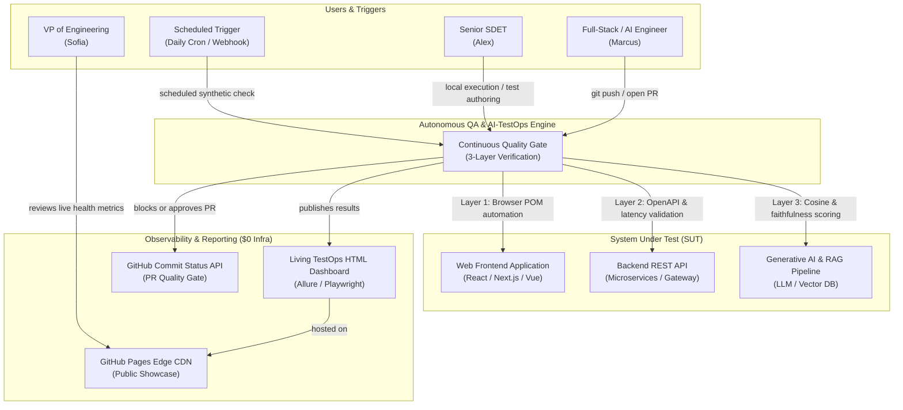
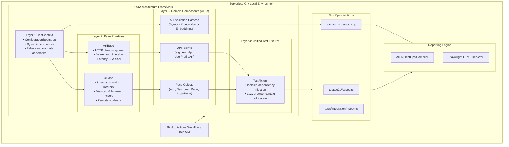
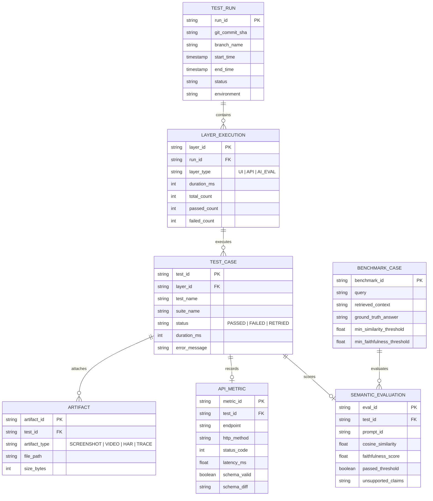
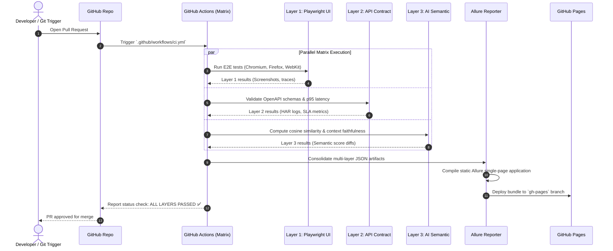
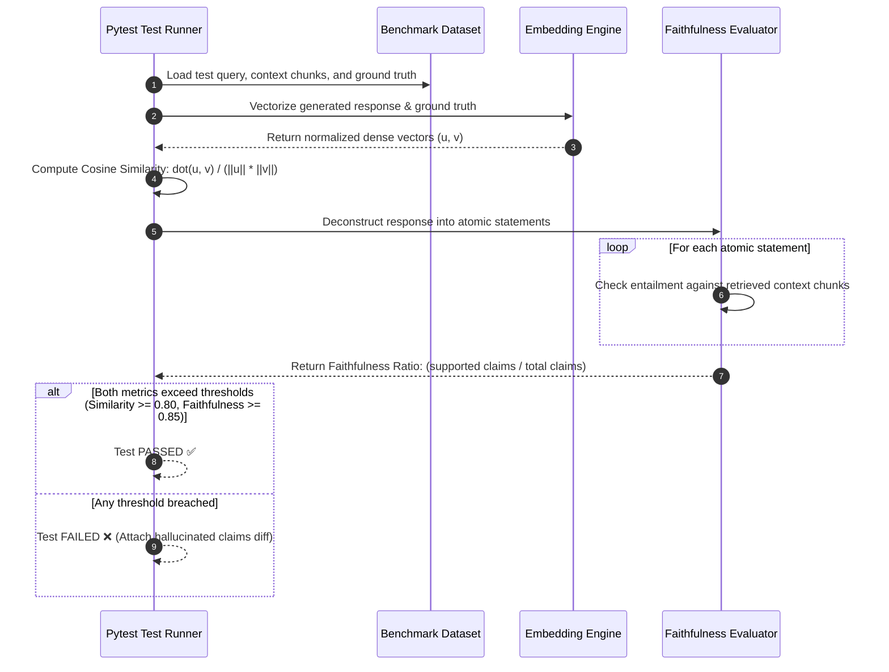

# SRS: Architecture Specifications - Autonomous QA & AI-TestOps Engine

> **Phase:** 2 - Architecture  
> **Document:** Software Requirements Specification (SRS) — Architecture Specifications  
> **Status:** Approved / Baseline  
> **Project Key:** `AQE`  

---

## 1. System Architecture (C4 Model)

The **Autonomous QA & AI-TestOps Engine** is engineered as an autonomous, serverless Quality Gate designed to run on ephemeral GitHub Actions runners and developer workstations. It evaluates the System Under Test (SUT) across three independent validation layers without requiring persistent cloud infrastructure.

### C4 Level 1: System Context Diagram



---

### C4 Level 2: Container & Engine Architecture

The engine is structured around the **KATA testing pattern**, isolating concerns into distinct architectural tiers to ensure maintainability, flake-resistance, and zero inter-test state leakage.



---

## 2. TestOps Data & Entity Model (ERD)

The engine models test execution, benchmark baselines, latency telemetry, and semantic metrics as structured relational entities stored as JSON artifacts and aggregated by Allure:



---

## 3. Technology Stack Justification

| Component | Selected Technology | Architectural Advantages | Trade-offs & Mitigations |
| :--- | :--- | :--- | :--- |
| **Core UI Automation** | **Playwright (TypeScript)** | • Auto-waiting eliminates race conditions without `waitForTimeout`<br/>• Native Chromium, Firefox, WebKit execution<br/>• Built-in tracing, network HAR capture, and video recording | • Requires browser binary downloads (`~400MB`); mitigated by GitHub Actions binary caching. |
| **Runtime & Package Manager** | **Bun (v1.1+)** | • $3\times$ faster startup and script execution than Node.js<br/>• Native TypeScript execution without transpile step<br/>• Rapid dependency installation ($< 10\text{s}$) | • Node.js compatibility edge cases; mitigated by strictly avoiding non-standard Bun APIs in shared test code. |
| **API Contract Validation** | **Ajv / JSON Schema** | • Validates OpenAPI 3.0/3.1 specs against live payloads in $< 5\text{ms}$<br/>• Strict schema checking flags unexpected properties<br/>• Automatic TypeScript type generation via `bun run api:sync` | • Requires maintaining schema synchronicity; mitigated by automated OpenAPI sync script. |
| **AI Semantic Evaluation** | **Python 3.11+ & Pytest** | • Native access to high-performance vector math libraries (`numpy`, `scikit-learn`)<br/>• Extensive RAG evaluation ecosystem<br/>• Simple, readable parameterized test cases | • Introduces a dual-language repository (TypeScript + Python); mitigated by unified CLI execution (`bun run test:all`). |
| **Vector Embeddings** | **Fast Dense Embeddings (Local/API)** | • High-precision vector cosine similarity scoring ($[-1, 1]$)<br/>• Fast computation ($< 50\text{ms}$ per test pair)<br/>• Deterministic outputs under fixed seeds | • Embedding API rate limits or latency; mitigated by using lightweight cached models for CI runs. |
| **CI/CD Infrastructure** | **GitHub Actions** | • **$0.00 fixed infrastructure cost** on ephemeral Linux VMs<br/>• Native GitHub event triggers (`push`, `pull_request`, `cron`)<br/>• Out-of-the-box parallel matrix job spawning | • Standard runner CPU limits (2 vCPUs); mitigated by splitting layers across parallel matrix jobs. |
| **Living TestOps Showcase** | **GitHub Pages Edge CDN** | • $0 hosting spend with instant global distribution<br/>• Direct living URL embedded in `README.md`<br/>• Public visibility for stakeholders without login barriers | • Static hosting only (no dynamic server backend); mitigated by compiling rich static single-page apps (Allure). |
| **Visual Reporting** | **Allure TestOps / HTML** | • Rich interactive timelines, screenshots, and HAR attachments<br/>• Multi-language result aggregation (TypeScript + Python)<br/>• Clear visual diffs for AI faithfulness scores | • Additional compilation step; completed in $< 30$ seconds in the CI aggregation job. |

---

## 4. Execution & Data Flow Architecture

### Flow 1: 3-Layer Parallel CI/CD Quality Gate Pipeline



---

### Flow 2: Layer 3 RAG Semantic Evaluation & Faithfulness Fencing



---

## 5. Security & Isolation Architecture

```
┌──────────────────────────────────────────────────────────────────┐
│                   SECURITY & ISOLATION BOUNDARIES                │
├──────────────────────────────────────────────────────────────────┤
│                                                                  │
│  1. EPHEMERAL VM ISOLATION                                       │
│     • GitHub Actions Ubuntu VM provisioned fresh per job         │
│     • Complete disk destruction post-run; zero cross-job leakage │
│                                                                  │
│  2. SECRET SANITIZATION GATEWAY                                  │
│     • Console stdout/stderr regex filter masks all API keys      │
│     • HAR network logs strip Authorization and Cookie headers    │
│     • Allure HTML reports scrub environment variables            │
│                                                                  │
│  3. LEAST-PRIVILEGE PERMISSIONS (GITHUB_TOKEN)                   │
│     • contents: write (strictly for gh-pages deployment branch)  │
│     • statuses: write (strictly for commit status check badges)  │
│     • pull-requests: write (for PR failure summary comments)     │
│     • All other repository permissions set to NONE               │
│                                                                  │
└──────────────────────────────────────────────────────────────────┘
```

1. **Secret Masking:** Environment variables containing sensitive credentials (`OPENAI_API_KEY`, `AUTH_TOKEN`) are registered as masked secrets in GitHub Actions. Pre-reporting sanitizers scrub all tokens from network HAR logs, screenshots, and console traces before Allure report generation.
2. **Deterministic Isolation:** Each test case creates its own isolated browser context with distinct storage state and ephemeral faker credentials, guaranteeing that no cookies, local storage, or session tokens persist between tests.
3. **Reproducible AI Environments:** The Python evaluation virtual environment is pinned with exact dependency hashes in `requirements.txt`, preventing supply-chain regressions or mathematical drift in vector operations.
