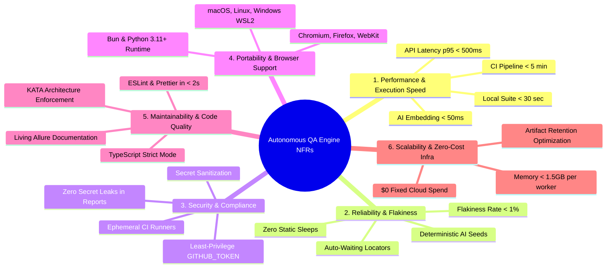

# SRS: Non-Functional Specifications - Autonomous QA & AI-TestOps Engine

> **Phase:** 2 - Architecture  
> **Document:** Software Requirements Specification (SRS) — Non-Functional Specifications (NFRs)  
> **Status:** Approved / Baseline  
> **Project Key:** `AQE`  

---

## 1. Overview & Requirements Categorization

This document establishes the non-functional performance benchmarks, reliability standards, security constraints, maintainability criteria, and architectural bounds governing the **Autonomous QA & AI-TestOps Engine**. Every requirement is strictly quantified to avoid ambiguity.

---

## 2. Non-Functional Requirements Specification

### 1. Performance & Execution Speed

| Requirement ID | Metric / Parameter | Target SLA | Verification Method |
| :--- | :--- | :--- | :--- |
| **`NFR-PERF-001`** | **Full CI Pipeline Duration** | $< 5\text{ minutes}$ | Total GitHub Actions workflow wall-clock time across all 3 parallel layers |
| **`NFR-PERF-002`** | **Local Suite Execution** | $< 30\text{ seconds}$ | Local execution of baseline suite via `bun run test:all` on standard M-series / x86 machine |
| **`NFR-PERF-003`** | **Layer 1 (UI POM) Step Transition** | $< 500\text{ms}$ per action | Playwright action duration excluding external network latency |
| **`NFR-PERF-004`** | **Layer 2 (API) Contract Overhead** | $< 5\text{ms}$ per request | JSON Schema validation compute time per response payload |
| **`NFR-PERF-005`** | **Layer 2 (API) Endpoint Latency SLA** | $p95 < 500\text{ms}$, $p99 < 1000\text{ms}$ | Automated latency percentile assertions measured across test repetitions |
| **`NFR-PERF-006`** | **Layer 3 (AI) Embedding Scoring** | $< 50\text{ms}$ per test pair | Vector encoding and cosine similarity computation duration using fast local embeddings |
| **`NFR-PERF-007`** | **Report Build & Edge Deployment** | $< 60\text{ seconds}$ | Allure SPA compilation and GitHub Pages CDN propagation time |

---

### 2. Reliability & Flakiness Elimination

| Requirement ID | Parameter | Specification | Enforcement Mechanism |
| :--- | :--- | :--- | :--- |
| **`NFR-REL-001`** | **CI/CD Flakiness Rate** | $< 1\%$ false-positive failure rate | Validated over 100 consecutive GitHub Actions runs on the primary branch |
| **`NFR-REL-002`** | **Zero Static Sleeps** | $0$ arbitrary delay calls | Prohibits `page.waitForTimeout()` or `time.sleep()`; enforced via ESLint custom AST rules |
| **`NFR-REL-003`** | **Smart Auto-Waiting** | $100\%$ locator actionability | All browser interactions rely on Playwright auto-waiting (`attached`, `visible`, `stable`, `enabled`) |
| **`NFR-REL-004`** | **Transient Network Retry** | Maximum 1 retry in CI only | Configured in `playwright.config.ts` (`retries: process.env.CI ? 1 : 0`); traces captured on retry only |
| **`NFR-REL-005`** | **AI Evaluation Determinism** | Reproducible scoring | Enforces fixed model random seeds (`seed: 42`) and temperature $0.0$ for deterministic regression benchmarks |

---

### 3. Security, Privacy & Secret Sanitization

| Requirement ID | Domain | Specification | Mitigation / Standard |
| :--- | :--- | :--- | :--- |
| **`NFR-SEC-001`** | **Secret Masking & Sanitization** | $100\%$ credential scrub rate | Automated masking of API keys (`OPENAI_API_KEY`, tokens) in console stdout, HAR files, and Allure reports |
| **`NFR-SEC-002`** | **Ephemeral CI Environment** | Zero disk persistence | All test executions run on fresh Ubuntu virtual machines discarded immediately upon job termination |
| **`NFR-SEC-003`** | **Least-Privilege GitHub Token** | Scoped `GITHUB_TOKEN` permissions | Actions workflow granted strictly `contents: write` (for GitHub Pages publishing) and `statuses: write` (for PR commit checks) |
| **`NFR-SEC-004`** | **Dependency Security Audit** | Zero critical/high CVEs | Automated dependency scanning via `bun audit` and GitHub Dependabot |
| **`NFR-SEC-005`** | **Input & Payload Sanitization** | Defensive fuzzing | All test payloads sent to API and AI endpoints are validated against injection patterns (SQLi, prompt injection) |

---

### 4. Portability & Browser Support

| Requirement ID | Environment | Supported Platforms & Versions | Success Criteria |
| :--- | :--- | :--- | :--- |
| **`NFR-PORT-001`** | **Desktop Browser Engines** | Chromium (latest 2 versions), Firefox (latest 2 versions), WebKit (Safari engine) | $100\%$ pass parity across all 3 engines in headless CI |
| **`NFR-PORT-002`** | **Mobile Device Emulation** | Pixel 7 (Android/Chromium) and iPhone 14 (iOS/WebKit) mobile viewports | Responsive viewport assertions pass without visual clipping |
| **`NFR-PORT-003`** | **Developer Operating Systems** | macOS (Apple Silicon M1-M4 & Intel x64), Linux (Ubuntu 22.04+), Windows (WSL2 & native) | Native local execution passes without OS-specific code changes |
| **`NFR-PORT-004`** | **Runtime Engines** | Bun (v1.1+) or Node.js (v18+) for TypeScript; Python 3.11+ for AI evaluation | Clean dependency resolution without native toolchain compilation errors |

---

### 5. Maintainability & Code Quality

| Requirement ID | Target Area | Standard / Policy | Tooling / Check |
| :--- | :--- | :--- | :--- |
| **`NFR-MAINT-001`**| **TypeScript Strictness** | Strict typing enabled (`strict: true`, `noImplicitAny: true`, `moduleDetection: force`) | Verified via `tsconfig.json` and `bun run lint` |
| **`NFR-MAINT-002`**| **KATA Architecture Enforcement** | Strict layer separation (TestContext $\rightarrow$ UiBase/ApiBase $\rightarrow$ ATCs $\rightarrow$ Fixtures) | Spec files must never import raw Playwright `page` or `request` primitives directly |
| **`NFR-MAINT-003`**| **Pre-Commit Hook Speed** | $< 2\text{ seconds}$ execution | Husky + `lint-staged` executing ESLint (`--fix`) and Prettier on staged files only |
| **`NFR-MAINT-004`**| **Path Aliasing** | 100% path alias usage | Relative parent imports (`../../`) forbidden; strictly enforces `@ui/`, `@api/`, `@schemas/`, `@utils/` |
| **`NFR-MAINT-005`**| **Code Documentation** | TSDoc / Python Docstrings | All exported Page Objects, ATC methods, and semantic scoring utilities must have structured API documentation |

---

### 6. Scalability & Zero-Cost Infrastructure

| Requirement ID | Resource | Target Constraint | Operational Strategy |
| :--- | :--- | :--- | :--- |
| **`NFR-SCALE-001`**| **Fixed Infrastructure Cost** | **$0.00 / month** | Leverages standard public GitHub Actions runner minutes and GitHub Pages free Edge CDN |
| **`NFR-SCALE-002`**| **Runner Memory Consumption** | $< 1.5\text{ GB}$ RAM per browser worker | Runs cleanly on standard 2-core / 7GB RAM GitHub Actions Linux runners |
| **`NFR-SCALE-003`**| **Artifact Storage Footprint** | $< 500\text{ MB}$ total retained artifact size | Screenshots, videos, and network traces captured strictly on failure; retained for 14 days maximum |
| **`NFR-SCALE-004`**| **CI Runner Cache Hit Rate** | $\ge 90\%$ cache hit rate | Content-addressable caching for Bun modules, Playwright browser binaries, and Python virtual environment |

---

### 7. Observability & Report Accessibility

| Requirement ID | Feature | Specification | User Impact |
| :--- | :--- | :--- | :--- |
| **`NFR-OBS-001`** | **Public Edge Access** | Instant global CDN access via GitHub Pages | Stakeholders, managers, and recruiters review live test results without login friction |
| **`NFR-OBS-002`** | **Accessibility (a11y)** | WCAG 2.1 Level AA compliance on report pages | High contrast ($\ge 4.5:1$), keyboard-navigable tabs, and accessible status badges |
| **`NFR-OBS-003`** | **Root-Cause Diagnostics** | Complete diagnostic artifacts on test failure | Full-page failure screenshot, DOM snapshot, HAR network log, and textual claim diffs attached directly to failed test |
| **`NFR-OBS-004`** | **Real-Time Status Badges** | SVG badges updated within $< 60$ seconds | Dynamically reflects primary branch Quality Gate status in project `README.md` |
