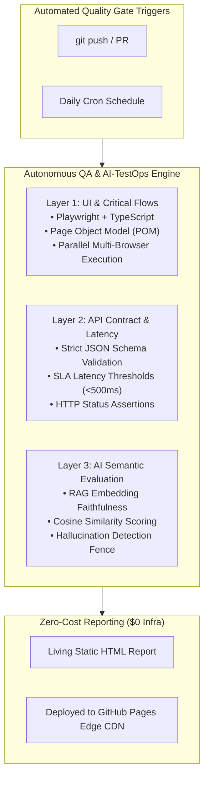

# Autonomous QA & AI-TestOps Engine

> **Continuous Quality Gate for Web Applications, REST APIs, and Generative AI (LLM / RAG) Systems.**

[](https://github.com/marttinroman/autonomous-qa-engine/actions)
[](https://playwright.dev/)
[](https://www.typescriptlang.org/)
[](https://www.python.org/)
[](LICENSE.md)
[](https://marttinroman.github.io)

---

## 1. Executive Summary & Business Idea

Modern cloud architectures combine reactive web interfaces, microservices, and non-deterministic Generative AI (LLM / RAG) workflows. In fast-paced engineering teams, three critical bottlenecks routinely damage product reliability and release velocity:

1. **AI Output Hallucinations & Drift:** Traditional deterministic assertions (`assert response.body == expected`) cannot detect semantic regressions, source fabrication, or prompt drift.
2. **CI/CD Flakiness:** Heavy, brittle end-to-end tests with high false-positive rates stall engineering pipelines.
3. **Runaway Tooling Costs:** Proprietary enterprise synthetic testing and LLM monitoring suites often demand thousands of dollars monthly in licensing and dedicated cloud infrastructure.

**The Solution:** The **Autonomous QA & AI-TestOps Engine** is an open-source, serverless Quality Gate designed to run seamlessly on ephemeral GitHub Actions runners with a **$0 recurring infrastructure cost**. It consolidates three distinct verification layers into a unified pipeline before and after production releases.

---

## 2. 3-Layer Validation Architecture



### Layer 1: UI & Critical Flows

- **Framework:** Playwright + TypeScript.
- **Patterns:** Page Object Model (POM), custom isolated fixtures, auto-waiting locators.
- **Execution:** Headless multi-browser parallelization across Chromium, Firefox, and WebKit.

### Layer 2: API Contract & Latency Validation

- **Validation:** Strict OpenAPI & JSON schema conformance checking.
- **Performance:** Enforces percentile response time budgets ($p95 < 500\text{ms}$).
- **Resilience:** Automatic status code validation and contract drift warnings.

### Layer 3: AI Semantic Evaluation (RAG Harness)

- **Scoring:** Measures cosine similarity of vector embeddings between generated answers and ground-truth retrieved context.
- **Faithfulness:** Verifies factual grounding to eliminate hallucinations.
- **Safety:** Automated prompt regression tests whenever system prompts or model versions update.

---

## 3. Tech Stack

- **Core Automation:** Playwright, TypeScript, Python 3.11+, pytest.
- **AI Evaluation:** Embedding models, cosine semantic scoring, JSON schema validators.
- **CI/CD & Hosting:** GitHub Actions (Linux VM runners), GitHub Pages.
- **Reporting:** Allure TestOps, Playwright HTML Reporter.

---

## 4. Quickstart

### Prerequisites

- Node.js (v18+) or [Bun](https://bun.sh)
- Python 3.11+

### Installation

```bash
# Clone the repository
git clone https://github.com/marttinroman/autonomous-qa-engine.git
cd autonomous-qa-engine

# Install Node dependencies
bun install   # or npm install

# Install Playwright browsers
bunx playwright install --with-deps

# Install Python evaluation dependencies
pip install -r requirements.txt
```

### Running the Quality Gate

```bash
# Execute Layer 1 (UI Tests)
bun run test:e2e

# Execute Layer 2 (API Contracts)
bun run test:api

# Execute Layer 3 (AI RAG Harness)
python -m pytest tests/ai_eval/ -v
```

---

## 5. Author & Contact

**Marttin Roman**  
_Senior QA Automation Engineer & SDET | AI-TestOps Specialist_

- **Portfolio:** [marttinroman.github.io](https://marttinroman.github.io)
- **LinkedIn:** [linkedin.com/in/marttinroman](https://linkedin.com/in/marttinroman)
- **Email:** [marttinroman@gmail.com](mailto:marttinroman@gmail.com)

---

## 6. License

This project is licensed under the [MIT License](LICENSE.md).
