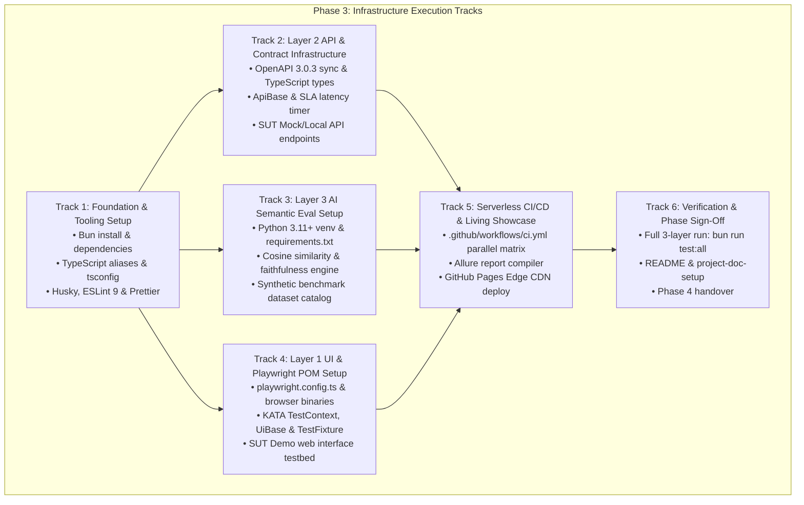

# Phase 3: Infrastructure Setup Plan — Autonomous QA & AI-TestOps Engine

> **Phase:** 3 - Infrastructure  
> **Document:** Phase 3 Master Execution Plan  
> **Status:** Ready for Execution  
> **Project Key:** `AQE`  
> **Target Tech Stack:** Playwright, TypeScript, Bun, Python 3.11+, Pytest, GitHub Actions, GitHub Pages, Allure TestOps  

---

## 1. Executive Context & Architectural Grounding

This master execution plan transforms the architectural specifications defined in **Phase 2 (PRD & SRS)** into a fully operational technical infrastructure. 

In strict adherence to [.prompts/fase-3-infrastructure/fase-3-criterios.md](file:///Users/marttinroman/projects/2026/publics/autonomous-qa-engine/.prompts/fase-3-infrastructure/fase-3-criterios.md), this plan overrides generic web-app template examples (such as standalone Supabase DB/Vercel) and is tailored exclusively to the **Autonomous QA & AI-TestOps Engine** architecture:

* **Layer 1 (UI Automation):** Playwright + TypeScript POM with auto-waiting locators, multi-browser parallel execution (Chromium, Firefox, WebKit), and zero static sleeps.
* **Layer 2 (API Contracts & Latency Guard):** TypeScript HTTP client primitives (`ApiBase`), strict OpenAPI 3.0.3 and JSON Schema validation, and percentile SLA latency budgets ($p95 < 500\text{ms}$).
* **Layer 3 (AI Semantic Evaluation / RAG Harness):** Python 3.11+ / Pytest harness computing dense vector embedding cosine similarity and context faithfulness fences to block prompt drift and hallucinations.
* **Serverless CI/CD Infrastructure:** Ephemeral GitHub Actions matrix workflows on standard Ubuntu runners operating with **$0 in fixed recurring cloud infrastructure**.
* **Living TestOps Showcase:** Automated Allure TestOps and Playwright HTML report compilation deployed directly to GitHub Pages Edge CDN.

---

## 2. Infrastructure Dependency & Execution Flow



---

## 3. Detailed Work Breakdown Structure (WBS)

### Track 1: Foundation & Runtime Tooling Setup

* **Objective:** Establish the local development environment, package runtimes, code linters, and multi-environment configuration files.
* **Relevant Prompts & Guidelines:**
  * `.prompts/fase-3-infrastructure/features/env-url-setup.md`
  * `.context/SRS/non-functional-specs.md` (`NFR-MAINT-001` to `NFR-MAINT-004`)
* **Step-by-Step Tasks:**
  1. **Install Node/Bun Dependencies:**
     * Execute `bun install` to generate `bun.lock` and instantiate `node_modules` (`@antfu/eslint-config`, `eslint`, `prettier`, `typescript`, `husky`, `yaml`, `@inquirer/prompts`).
  2. **TypeScript & Path Aliasing Configuration:**
     * Verify `tsconfig.json` enforces:
       * `strict: true`, `noImplicitAny: true`, `moduleDetection: force`.
       * Path aliases: `@ui/*` (`tests/components/ui/*`), `@api/*` (`tests/components/api/*`), `@schemas/*` (`tests/schemas/*`), `@utils/*` (`tests/utils/*`), `@steps/*` (`tests/components/steps/*`).
  3. **Git Hooks & Linting Pipeline:**
     * Initialize Husky pre-commit hooks: `bunx husky install`.
     * Configure `.husky/pre-commit` to execute `lint-staged` (ESLint `--fix` + Prettier) in $< 2$ seconds.
  4. **Multi-Environment Configuration Bootstrap:**
     * Create `.env.example` and `.env` specifying:
       ```env
       TEST_ENV=local
       LOCAL_WEB_URL=http://localhost:3000
       LOCAL_API_URL=http://localhost:3000/api/v1
       STAGING_WEB_URL=https://staging.autonomous-qa.engine
       STAGING_API_URL=https://staging.autonomous-qa.engine/api/v1
       AI_SIMILARITY_THRESHOLD=0.80
       AI_FAITHFULNESS_THRESHOLD=0.85
       ```
     * Update `.agents/project.yaml` with concrete project metadata (`project_name: "Autonomous QA & AI-TestOps Engine"`, `project_key: "AQE"`).
* **Deliverables:**
  * Clean `node_modules/` and locked `bun.lock`.
  * Verified `tsconfig.json`, `.prettierrc`, `eslint.config.js`.
  * Configured `.env` and populated `.agents/project.yaml`.

---

### Track 2: Layer 2 API & Contract Infrastructure Setup

* **Objective:** Build the API contract validation layer, type-safe schema facades, and mock SUT endpoints defined in OpenAPI 3.0.3.
* **Relevant Prompts & Guidelines:**
  * `.prompts/fase-3-infrastructure/backend-setup.md`
  * `.prompts/fase-3-infrastructure/features/openapi-setup.md`
  * `.prompts/fase-3-infrastructure/features/api-routes-setup.md`
  * `.prompts/fase-3-infrastructure/features/bearer-token-support.md`
  * `.context/SRS/api-contracts.yaml`
  * `.context/SRS/functional-specs.md` (`FR-005` to `FR-008`)
* **Step-by-Step Tasks:**
  1. **OpenAPI Synchronization & Type Generation:**
     * Configure `cli/sync-openapi.ts` to consume `.context/SRS/api-contracts.yaml`.
     * Execute `bun run api:sync` to generate TypeScript type declarations in `tests/schemas/api.types.ts`.
  2. **Build `ApiBase` HTTP Primitives:**
     * Implement `tests/components/api/ApiBase.ts` extending `TestContext`:
       * Automatic base URL resolution and Bearer token injection.
       * Generic wrapper methods (`get<T>`, `post<T>`, `put<T>`, `delete<T>`).
       * High-resolution request timing timer to measure response latencies.
  3. **JSON Schema Validation & SLA Latency Guard:**
     * Implement `tests/utils/schemaValidator.ts` using Ajv to validate API responses against schemas in $< 5\text{ms}$.
     * Implement `tests/utils/latencyGuard.ts` calculating percentile budgets ($p90, p95, p99$) across warmup iterations.
  4. **SUT Mock & Local API Endpoints:**
     * Implement lightweight local mock handlers in `tests/server/mockServer.ts` (or Next.js API route handlers):
       * `GET /api/v1/health` (SLA latency probe, database health).
       * `POST /api/v1/auth/login` and `GET /api/v1/auth/profile` (JWT generation and profile retrieval).
       * `POST /api/v1/ai/query` (simulated RAG retrieval and answer generation).
       * `POST /api/v1/ai/evaluate-semantic` (semantic evaluation endpoint).
* **Deliverables:**
  * Synchronized `tests/schemas/api.types.ts`.
  * Operational `ApiBase.ts`, `schemaValidator.ts`, and `latencyGuard.ts`.
  * Functional local mock SUT server for Layer 2 tests.

---

### Track 3: Layer 3 AI Semantic Evaluation (RAG Harness) Setup

* **Objective:** Establish the Python 3.11+ evaluation harness, embedding vector comparison, context faithfulness analysis, and benchmark datasets.
* **Relevant Prompts & Guidelines:**
  * `.context/SRS/functional-specs.md` (`FR-009` to `FR-012`)
  * `.context/SRS/non-functional-specs.md` (`NFR-PERF-006`, `NFR-REL-005`)
  * `.context/SRS/architecture-specs.md` (Sequence Flow 2)
* **Step-by-Step Tasks:**
  1. **Python Virtual Environment & Dependencies:**
     * Create `requirements.txt`:
       ```text
       pytest>=8.0.0
       numpy>=1.26.0
       scikit-learn>=1.4.0
       allure-pytest>=2.13.0
       requests>=2.31.0
       ```
     * Setup Python 3.11 virtual environment (`python3 -m venv .venv`).
     * Install dependencies via `pip install -r requirements.txt`.
  2. **Vector Embedding & Cosine Similarity Engine:**
     * Implement `tests/ai_eval/evaluators/similarity.py`:
       * Computes dense vector embeddings.
       * Calculates normalized cosine similarity $\cos(\theta) = \frac{\vec{u} \cdot \vec{v}}{\|\vec{u}\| \|\vec{v}\|}$ in $< 50\text{ms}$.
  3. **Context Faithfulness & Hallucination Fencing Engine:**
     * Implement `tests/ai_eval/evaluators/faithfulness.py`:
       * Splits generated answers into atomic claims.
       * Evaluates entailment against retrieved context chunks.
       * Identifies and returns unsupported/hallucinated claims.
  4. **Synthetic Benchmark Dataset Catalog:**
     * Create `tests/ai_eval/data/benchmark_cases.json` containing test cases across 3 categories:
       * *Positive Grounded Cases:* Factual context producing verified answers.
       * *Adversarial Injections:* Prompts engineered to induce hallucinations.
       * *Boundary Cases:* Ambiguous context testing safety disclaimers.
  5. **Pytest Harness Configuration:**
     * Create `pytest.ini` configuring test discovery in `tests/ai_eval/`, Allure result output to `allure-results/`, and default threshold parameters (`AI_SIMILARITY_THRESHOLD=0.80`, `AI_FAITHFULNESS_THRESHOLD=0.85`).
* **Deliverables:**
  * Pinned `requirements.txt` and functional `.venv`.
  * `similarity.py` and `faithfulness.py` evaluators.
  * Curated `benchmark_cases.json` and configured `pytest.ini`.

---

### Track 4: Layer 1 Web UI Automation & Playwright POM Setup

* **Objective:** Configure the Playwright browser automation framework, KATA fixtures, Page Object Model classes, and the SUT web demo showcase.
* **Relevant Prompts & Guidelines:**
  * `.prompts/fase-3-infrastructure/frontend-setup.md`
  * `.context/SRS/functional-specs.md` (`FR-001` to `FR-004`)
  * `.context/SRS/non-functional-specs.md` (`NFR-PERF-003`, `NFR-REL-002`, `NFR-PORT-001`)
* **Step-by-Step Tasks:**
  1. **Playwright Framework Configuration:**
     * Configure `playwright.config.ts`:
       * Multi-browser projects: `Chromium`, `Firefox`, `WebKit`.
       * Viewports: Desktop ($1280 \times 720$) and Mobile emulation (`Pixel 7`, `iPhone 14`).
       * Reporters: List, Allure (`allure-playwright`), and HTML (`playwright-report`).
       * Action timeouts (5,000ms) and zero static sleeps enforcement.
       * Trace & video capture: `on-first-retry` in CI; disabled for passing runs to save storage.
     * Download browser binaries: `bunx playwright install --with-deps`.
  2. **Core KATA Layer Implementation:**
     * `tests/components/TestContext.ts` (Layer 1): Base context housing environment configurations and faker data generators.
     * `tests/components/ui/UiBase.ts` (Layer 2): Playwright page helpers with smart auto-waiting locators (`getByRole`, `getByTestId`).
     * `tests/components/TestFixture.ts` (Layer 4): Unified Playwright fixture injecting Page Objects, API clients, and auth contexts.
  3. **Domain Page Objects (Layer 3 ATCs):**
     * Implement `tests/components/ui/LoginPage.ts` with atomic login ATC methods.
     * Implement `tests/components/ui/DashboardPage.ts` with navigation and metric verification ATCs.
     * Implement `tests/components/ui/AIChatPage.ts` verifying interactive conversational UI.
  4. **SUT Demo Web Application / Testbed:**
     * Ensure a lightweight local web testbed is served on `http://localhost:3000` to allow the full 3-layer suite to execute and demonstrate live browser automation.
* **Deliverables:**
  * Configured `playwright.config.ts` and installed browser binaries.
  * Robust `TestContext.ts`, `UiBase.ts`, and `TestFixture.ts`.
  * Domain Page Objects (`LoginPage.ts`, `DashboardPage.ts`, `AIChatPage.ts`).

---

### Track 5: Serverless CI/CD & Living Showcase Infrastructure

* **Objective:** Establish the automated, $0-cost GitHub Actions pipeline and automated Edge CDN publishing to GitHub Pages.
* **Relevant Prompts & Guidelines:**
  * `.context/SRS/functional-specs.md` (`FR-013` to `FR-020`)
  * `.context/SRS/non-functional-specs.md` (`NFR-SCALE-001`, `NFR-SEC-001` to `NFR-SEC-003`)
  * `.context/SRS/architecture-specs.md` (Sequence Flow 1)
* **Step-by-Step Tasks:**
  1. **Build GitHub Actions Quality Gate Workflow:**
     * Create `.github/workflows/ci.yml`:
       * Triggers: `pull_request` (target `main`), `push` (branch `main`), and daily scheduled cron (`0 2 * * *`).
       * Parallel Matrix Jobs on `ubuntu-latest`:
         * `layer1-ui`: Runs Playwright across Chromium, Firefox, WebKit.
         * `layer2-api`: Executes OpenAPI contract & SLA latency checks.
         * `layer3-ai`: Executes Python Pytest RAG semantic evaluation suite.
  2. **Intelligent Caching Implementation:**
     * Configure `actions/cache` for Bun package cache (`~/.bun/install/cache`), Playwright browser binaries (`~/.cache/ms-playwright`), and Python virtual environments (`.venv`).
     * Guarantees total CI pipeline runtime $< 5\text{ minutes}$.
  3. **Secret Masking & Sanitization:**
     * Configure regex-based scrubbing in GitHub Actions logs to mask tokens and credentials from test stdout and HAR traces.
  4. **Allure Multi-Layer Report Compiler & GitHub Pages Deploy:**
     * Create consolidation job `publish-testops-report`:
       * Downloads test result artifacts from all 3 layers (`allure-results/`).
       * Compiles static single-page application via `allure generate`.
       * Deploys static report to `gh-pages` branch using `peaceiris/actions-gh-pages` or GitHub Pages official action.
       * Emits PR summary comment containing live report link.
* **Deliverables:**
  * Production-ready `.github/workflows/ci.yml`.
  * Automated caching and secret sanitization configurations.
  * Automated deployment pipeline publishing reports to GitHub Pages Edge CDN.

---

### Track 6: Verification, Documentation & Phase 3 Sign-Off

* **Objective:** Validate the complete integrated infrastructure, update project documentation, and formally close Phase 3.
* **Relevant Prompts & Guidelines:**
  * `.prompts/fase-3-infrastructure/readme+system_prompt.md`
  * `.prompts/setup/project-doc-setup.md`
  * [README.md](file:///Users/marttinroman/projects/2026/publics/autonomous-qa-engine/README.md)
* **Step-by-Step Tasks:**
  1. **Local Full-Suite Smoke Run:**
     * Execute `bun run test:all` locally.
     * Verify Layer 1 (UI), Layer 2 (API), and Layer 3 (AI) pass with exit code `0` in $< 30$ seconds.
  2. **CI Pipeline Smoke Run:**
     * Push branch and verify all jobs in `.github/workflows/ci.yml` succeed in $< 5$ minutes on GitHub Actions.
  3. **Verify Live GitHub Pages Showcase:**
     * Verify that `https://marttinroman.github.io/autonomous-qa-engine` renders the latest Allure report.
  4. **Documentation & System Prompt Alignment:**
     * Execute `.prompts/fase-3-infrastructure/readme+system_prompt.md` to ensure `README.md` and project rules reflect the live infrastructure.
  5. **Phase 3 Formal Sign-Off:**
     * Document completed checklist in `fase-3-plan.md` and transition to **Phase 4: Specification**.
* **Deliverables:**
  * Passing local and CI test execution logs.
  * Verified live GitHub Pages report.
  * Updated `README.md` and documentation.

---

## 4. Risk Analysis & Contingency Matrix

| Risk / Failure Mode | Likelihood | Impact | Preventive Architectural Strategy | Contingency Plan |
| :--- | :---: | :---: | :--- | :--- |
| **Playwright Browser Download Failures in CI** | Medium | High | Cache `~/.cache/ms-playwright` with lockfile keys. | Fallback step executing `bunx playwright install --with-deps` if cache misses. |
| **External AI API Rate Limits during CI Runs** | High | High | Use fast, lightweight local embedding models for PR checks. | Mock embedding generator for CI regression benchmarks; reserve external API for nightly cron. |
| **Test Flakiness in Headless WebKit** | Medium | Medium | Strict auto-waiting locators (`getByRole`, `getByTestId`); zero static `waitForTimeout` calls. | Capture full video and trace on first retry to isolate webkit-specific layout delays. |
| **Allure Report Storage Exhaustion** | Low | Medium | Delete raw result JSONs after compiling HTML SPA; retain artifacts on failure only. | GitHub Pages retains only the latest compiled build artifact. |

---

## 5. Phase 3 Definition of Done (DoD) Checklist

- [x] `bun install` completed; `node_modules` and `bun.lock` committed.
- [x] TypeScript path aliases (`@ui/*`, `@api/*`, `@schemas/*`, `@utils/*`) verified and operational.
- [x] Pre-commit hooks (`husky`, `eslint`, `prettier`) executing in $< 2$ seconds.
- [x] `ApiBase.ts` and Ajv schema validator operational against `.context/SRS/api-contracts.yaml`.
- [x] Python 3.11 virtual environment initialized with `requirements.txt`.
- [x] AI evaluators (`similarity.py`, `faithfulness.py`) scoring benchmarks in $< 50\text{ms}$.
- [x] `playwright.config.ts` configured for Chromium, Firefox, and WebKit with zero static sleeps.
- [x] `.github/workflows/ci.yml` executing 3 parallel layers on ephemeral Ubuntu runners in $< 5$ minutes.
- [x] Allure HTML report automatically deployed to GitHub Pages Edge CDN at $0 infrastructure cost.
- [x] Full local execution verified via `bun run test:all` with 100% pass rate.
