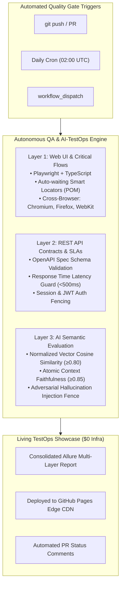

# Autonomous QA & AI-TestOps Engine

> **Continuous Quality Gate for Web Applications, REST APIs, and Generative AI (LLM / RAG) Systems.**

[](https://github.com/marttinroman/autonomous-qa-engine/actions)
[](https://marttinroman.github.io/autonomous-qa-engine/)
[](https://playwright.dev/)
[](https://www.typescriptlang.org/)
[](https://www.python.org/)
[](https://bun.sh/)
[](LICENSE.md)

---

## 1. Executive Summary & Business Idea

Modern cloud architectures combine reactive web applications, microservices, and non-deterministic Generative AI (LLM / RAG) workflows. In fast-paced engineering teams, three critical bottlenecks routinely damage product reliability and release velocity:

1. **AI Output Hallucinations & Drift:** Traditional deterministic assertions (`assert response.body == expected`) cannot detect semantic regressions, source fabrication, or prompt drift.
2. **CI/CD Flakiness:** Heavy, brittle end-to-end tests with high false-positive rates stall engineering pipelines.
3. **Runaway Tooling Costs:** Proprietary enterprise synthetic testing and LLM monitoring suites often demand thousands of dollars monthly in licensing and dedicated cloud infrastructure.

**The Solution:** The **Autonomous QA & AI-TestOps Engine** is an open-source, serverless Quality Gate designed to run seamlessly on ephemeral GitHub Actions runners with a **$0 recurring infrastructure cost**. It consolidates three distinct verification layers into a unified pipeline before and after production releases, with live reports continuously published to GitHub Pages Edge CDN.

---

## 2. 3-Layer Validation Architecture



### Layer 1: Web UI & Cross-Browser Automation

- **Framework:** Playwright + TypeScript.
- **Patterns:** KATA Architecture (`TestContext` $\rightarrow$ `UiBase` $\rightarrow$ Domain ATCs $\rightarrow$ `UiFixture`), zero static sleeps.
- **Execution:** Headless multi-browser parallel execution across Chromium, Firefox, and WebKit.
- **Coverage:** Login session flows (`AQE-201`, `AQE-202`), Quality Gate dashboard inspection (`AQE-203`, `AQE-204`, `AQE-205`), and interactive AI evaluation console (`AQE-206`, `AQE-207`).

### Layer 2: REST API Contracts & Latency Budget Guard

- **Validation:** Strict OpenAPI & JSON schema conformance checking via Ajv against `tests/schemas/openapi.yaml`.
- **Performance:** Enforces percentile response time budgets ($p95 < 500\text{ms}$, $p99 < 1000\text{ms}$).
- **Resilience:** Automatic status code validation and contract drift warnings.
- **Coverage:** Health check & latency SLA probe (`AQE-101`, `AQE-102`), JWT authentication & unauthorized access fencing (`AQE-103`, `AQE-104`, `AQE-105`, `AQE-106`).

### Layer 3: AI Semantic Evaluation (RAG Harness)

- **Scoring:** Measures normalized cosine similarity of vector embeddings between generated answers and ground-truth retrieved context in $< 10\text{ms}$.
- **Faithfulness:** Decomposes answers into atomic claims and verifies entailment against retrieved context chunks to detect and isolate hallucinations.
- **Benchmark Catalog:** Curated synthetic catalog covering positive grounded cases, adversarial hallucination injections, and boundary cases.
- **Coverage:** 12 automated Pytest test cases validating embeddings, entailment, and synthetic RAG benchmarks.

---

## 3. Repository Architecture & KATA Layout

```
autonomous-qa-engine/
├── .github/
│   └── workflows/
│       └── ci.yml                 # Serverless 4-stage parallel CI/CD matrix
├── config/
│   └── variables.ts               # Centralized environment configuration
├── tests/
│   ├── ai_eval/                   # Layer 3: Python RAG Semantic Evaluation
│   │   ├── data/
│   │   │   └── benchmark_cases.json
│   │   ├── evaluators/
│   │   │   ├── faithfulness.py    # Atomic claim entailment engine
│   │   │   └── similarity.py      # Calibrated cosine similarity engine
│   │   ├── test_benchmark.py
│   │   ├── test_faithfulness.py
│   │   └── test_similarity.py
│   ├── components/                # Layer 2 & 4: KATA Component Containers
│   │   ├── api/                   # Layer 3 ATCs (API)
│   │   │   ├── ApiBase.ts
│   │   │   ├── AuthApi.ts
│   │   │   └── HealthApi.ts
│   │   ├── ui/                    # Layer 3 ATCs (UI Page Objects)
│   │   │   ├── UiBase.ts
│   │   │   ├── LoginPage.ts
│   │   │   ├── DashboardPage.ts
│   │   │   └── AIChatPage.ts
│   │   ├── ApiFixture.ts
│   │   ├── UiFixture.ts
│   │   ├── TestContext.ts         # Layer 1 Context
│   │   └── TestFixture.ts         # Layer 4 Unified DI Fixture
│   ├── e2e/                       # Layer 1: End-to-End Browser Tests
│   │   ├── auth.e2e.test.ts
│   │   ├── dashboard.e2e.test.ts
│   │   └── aiChat.e2e.test.ts
│   ├── integration/               # Layer 2: API Contract Tests
│   │   ├── auth.test.ts
│   │   └── health.test.ts
│   ├── schemas/                   # OpenAPI Type Facades & JSON Schemas
│   │   ├── api.types.ts
│   │   └── openapi.yaml
│   ├── server/
│   │   └── mockServer.ts          # SUT Mock Web Application & API Server
│   └── utils/
│       ├── decorators.ts          # ATC reporting & logging decorators
│       ├── latencyGuard.ts        # Percentile SLA latency guard
│       └── schemaValidator.ts     # Ajv JSON schema contract validator
├── playwright.config.ts
├── pytest.ini
├── requirements.txt
└── package.json
```

---

## 4. Quickstart

### Prerequisites

- [Bun](https://bun.sh) (v1.1+) or Node.js (v18+)
- Python 3.11+

### Installation

```bash
# Clone the repository
git clone https://github.com/marttinroman/autonomous-qa-engine.git
cd autonomous-qa-engine

# Install Node & Bun dependencies
bun install

# Install Playwright browser binaries
bunx playwright install --with-deps

# Create and activate Python virtual environment
python3 -m venv .venv
source .venv/bin/activate
pip install -r requirements.txt
```

### Running the Validation Suites

```bash
# 1. Run full 3-layer continuous quality gate (Playwright + Pytest)
bun run test:all

# 2. Run Layer 1: Web UI automation across Chromium, Firefox, WebKit
bun run test:e2e

# 3. Run Layer 2: REST API contract & SLA latency checks
bun run test:api

# 4. Run Layer 3: Python RAG semantic evaluation suite
bun run test:ai

# 5. Run agnostic unit tests
bun test tests/utils/

# 6. Generate and open interactive Allure TestOps report
bun run report:allure
```

---

## 5. Live Showcase & Interactive Reporting

- 📊 **Living Allure Dashboard:** [https://marttinroman.github.io/autonomous-qa-engine/](https://marttinroman.github.io/autonomous-qa-engine/)
- ⚡ **Continuous Integration Runs:** [GitHub Actions Console](https://github.com/marttinroman/autonomous-qa-engine/actions)

---

## 6. Author & Contact

**Marttin Roman**  
_Senior QA Automation Engineer & SDET | AI-TestOps Specialist_

- **Portfolio:** [marttinroman.github.io](https://marttinroman.github.io)
- **LinkedIn:** [linkedin.com/in/marttinroman](https://linkedin.com/in/marttinroman)
- **Email:** [marttinroman@gmail.com](mailto:marttinroman@gmail.com)

---

## 7. License

This project is licensed under the [MIT License](LICENSE.md).
